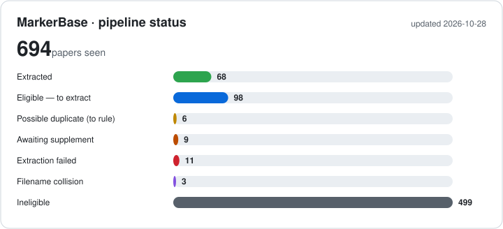

# IR MarkerBase — extraction pipeline

A pipeline that builds a database of **insecticide-resistance (IR) markers in
African *Anopheles*** from the literature: genotype counts at target markers
(kdr/Vgsc, Ace-1, Rdl, GSTe2, Cyp6p9a/b, Cyp6aa1, Cyp9k1) plus linked bioassays
and genotype–phenotype data, for spatial and temporal models of marker frequencies.

PDFs go into a Google Drive folder (or a local folder for testing). The pipeline
reads each one, decides whether it is eligible, extracts the data with an LLM,
checks it in code, and builds one combined table.

_Adapted from PfDR-MarkerBase-extract (P. falciparum drug resistance). The old
Pf data is preserved in git history (commit `7acfa7c`)._

## Status



<sub>Updates automatically on every run.</sub>

## Roster

<!-- ROSTER:START -->

**363 paper(s) · estimated spend $0.00** (eligibility $0.00 · extraction $0.00) · updated 2026-10-21

| id | source | status | eligible | confidence | duplicate_risk | needs_supplement | spec_version | first_seen | last_assessed | supp_attempts | supplement_fp | elig_model | elig_tok_in | elig_tok_out | extract_model | extract_tok_in | extract_tok_out | notes | est_$ |
|---|---|---|---|---|---|---|---|---|---|---|---|---|---|---|---|---|---|---|---|
| 07-1575 | master | EXTRACTED | True | high | none | False | 1 | 2026-10-13 | 2026-10-13 | 0 |  | gemini:gemini-3.7-flash | 5852 | 1799 | gemini:gemini-3.7-flash | 20693 | 50422 | 3 survey(s), 4 genotype, 0 bioassay, 12 geno-pheno rows; 16 warning(s) | 0.0000 |
| 1-s2.0-S0001706X19317632-main | master | EXTRACTED | True | high | none | False | 1 | 2026-10-08 | 2026-10-08 | 0 |  | gemini:gemini-3.5-flash | 5472 | 3401 | gemini:gemini-3.5-flash | 27742 | 56306 | 10 survey(s), 21 genotype, 19 bioassay, 0 geno-pheno rows; 23 warning(s) | 0.0000 |
| 1-s2.0-S0001706X21004691-main | master | EXTRACTED | True | high | none | False | 1 | 2026-10-13 | 2026-10-13 | 0 |  | gemini:gemini-3.7-flash | 6012 | 1558 | gemini:gemini-3.8-flash | 7681 | 14356 | 3 survey(s), 3 genotype, 9 bioassay, 0 geno-pheno rows | 0.0000 |
| 1471-2334-12-275 | master | EXTRACTED | True | high | none | False | 1 | 2026-10-13 | 2026-10-13 | 0 |  | gemini:gemini-3.7-flash | 6012 | 2128 | gemini:gemini-3.8-flash | 7873 | 10679 | 1 survey(s), 0 genotype, 3 bioassay, 2 geno-pheno rows; 2 warning(s) | 0.0000 |
| 1475-2875-12-151 | master | EXTRACTED | True | high | none | False | 1 | 2026-10-13 | 2026-10-13 | 0 |  | gemini:gemini-3.7-flash | 6012 | 1876 | gemini:gemini-3.7-flash | 7797 | 25279 | 3 survey(s), 6 genotype, 18 bioassay, 0 geno-pheno rows; 4 warning(s) | 0.0000 |
| 1475-2875-6-52 | master | INELIGIBLE |  |  |  |  | 1 | 2026-10-13 | 2026-10-13 | 0 |  | gemini:gemini-3-flash-preview | 4812 | 7985 |  |  |  | model returned no structured result — re-run or check by hand | 0.0000 |
| 1475-2875-7-178 (1) | master | EXTRACTED | True | high | none | False | 1 | 2026-10-12 | 2026-10-12 | 0 |  | gemini:gemini-3.8-flash | 7412 | 1719 | gemini:gemini-3.8-flash | 9134 | 15292 | 2 survey(s), 2 genotype, 0 bioassay, 0 geno-pheno rows | 0.0000 |
| 1475-2875-8-81 | master | EXTRACTED | True | high | none | False | 1 | 2026-10-13 | 2026-10-13 | 0 |  | gemini:gemini-3.8-flash | 5852 | 2055 | gemini:gemini-3.7-flash | 18618 | 47620 | 2 survey(s), 0 genotype, 2 bioassay, 4 geno-pheno rows; 3 warning(s) | 0.0000 |
| 1475-2875-9-83 | master | INELIGIBLE |  |  |  |  | 1 | 2026-10-13 | 2026-10-13 | 0 |  | gemini:gemini-3-flash-preview | 4932 | 7985 |  |  |  | model returned no structured result — re-run or check by hand | 0.0000 |
| 1756-3305-5-127 | master | EXTRACTED | True | high | none | False | 1 | 2026-10-08 | 2026-10-08 | 0 |  | gemini:gemini-3.5-flash | 6552 | 3606 | gemini:gemini-3.5-flash | 8246 | 37022 | 6 survey(s), 11 genotype, 37 bioassay, 0 geno-pheno rows | 0.0000 |
| 1756-3305-5-68 | master | EXTRACTED | True | high | low | False | 1 | 2026-10-13 | 2026-10-13 | 0 |  | gemini:gemini-3-flash-preview | 5472 | 3383 | gemini:gemini-3.8-flash | 7160 | 10140 | 1 survey(s), 2 genotype, 7 bioassay, 0 geno-pheno rows; 1 warning(s) | 0.0000 |
| 1756-3305-6-352 | master | EXTRACTED | True | high | low | False | 1 | 2026-10-08 | 2026-10-08 | 0 |  | gemini:gemini-3.5-flash | 8172 | 1632 | gemini:gemini-3.5-flash | 9816 | 31601 | 10 survey(s), 6 genotype, 8 bioassay, 7 geno-pheno rows | 0.0000 |
| 1756-3305-7-213 | master | INELIGIBLE |  |  |  |  | 1 | 2026-10-13 | 2026-10-13 | 0 |  | gemini:gemini-3-flash-preview | 6552 | 7985 |  |  |  | model returned no structured result — re-run or check by hand | 0.0000 |
| 1756-3305-7-450 | master | INELIGIBLE | False | high | high | False | 1 | 2026-10-13 | 2026-10-13 | 0 |  | gemini:gemini-3-flash-preview | 9252 | 3201 |  |  |  |  | 0.0000 |
| 1998_Brogdon_Insecticide_Resistance_Vector_Control_PMID9866736 | master | INELIGIBLE | False | high | none | False | 1 | 2026-10-17 | 2026-10-17 | 0 |  | gemini:gemini-3.7-flash | 6372 | 943 |  |  |  |  | 0.0000 |
| 2001_Reiter_Climate_Change_Mosquito_Borne_Disease_PMID11250812 | master | INELIGIBLE | False | high | none | False | 1 | 2026-10-16 | 2026-10-16 | 0 |  | gemini:gemini-3.5-flash | 12612 | 1346 |  |  |  |  | 0.0000 |
| 2004_Etang_Reduced_Bio_Efficacy_Permethrin_EC_PMID15569394 | master | INELIGIBLE | False | high | low | False | 1 | 2026-10-18 | 2026-10-18 | 0 |  | gemini:gemini-3-flash-preview | 5332 | 2748 |  |  |  |  | 0.0000 |
| 2006_Adams_Abstracts_Fifth_International_Symposium_Molecular_PMC2990333 | master | INELIGIBLE | False | high | none | False | 1 | 2026-10-16 | 2026-10-16 | 0 |  | gemini:gemini-3.5-flash | 40692 | 2008 |  |  |  |  | 0.0000 |
| 2006_Akogbeto_Screening_Pesticide_Residues_Soil_Water_PMID16563153 | master | EXTRACTED | True | high | none | False | 1 | 2026-10-17 | 2026-10-17 | 0 |  | gemini:gemini-3.5-flash | 6372 | 3116 | gemini:gemini-3.5-flash | 19581 | 20500 | 2 survey(s), 2 genotype, 6 bioassay, 0 geno-pheno rows; 2 warning(s) | 0.0000 |
| 2006_Anyanwu_Health_Effects_Long_Term_Exposure_PMID17173181 | master | INELIGIBLE | False | high | none | False | 1 | 2026-10-17 | 2026-10-17 | 0 |  | gemini:gemini-3.7-flash | 7412 | 928 |  |  |  |  | 0.0000 |
| 2006_Kamau_Status_Insecticide_Susceptibility_Anopheles_Arabie_PMID16756645 | master | INELIGIBLE | False | high | none | False | 1 | 2026-10-19 | 2026-10-19 | 0 |  | gemini:gemini-3.1-flash-lite | 4812 | 682 |  |  |  |  | 0.0000 |
| 2006_Kulkarni_Occurrence_Leucine_Phenylalanine_Knockdown_Resista_PMID16820067 | master | ELIGIBLE | True | high | none | False | 1 | 2026-10-20 | 2026-10-20 | 0 |  | gemini:gemini-3.8-flash | 5332 | 1794 |  |  |  |  | 0.0000 |
| 2006_Mazzoni_Molecular_Polymorphism_Differentiation_Introgressi_PMID17069656 | master | INELIGIBLE | False | high | none | False | 1 | 2026-10-16 | 2026-10-16 | 0 |  | gemini:gemini-3.5-flash | 7412 | 1339 |  |  |  |  | 0.0000 |
| 2007_Casimiro_Monitoring_Operational_Impact_Insecticide_Usage_PMID17973989 | master | INELIGIBLE | False | high | low | False | 1 | 2026-10-20 | 2026-10-20 | 0 |  | gemini:gemini-3-flash-preview | 5332 | 5381 |  |  |  |  | 0.0000 |
| 2007_Djouaka_Does_Spillage_Petroleum_Products_Anopheles_PMID18053173 | master | EXTRACTED | True | high | low | False | 1 | 2026-10-18 | 2026-10-18 | 0 |  | gemini:gemini-3.7-flash | 6892 | 4252 | gemini:gemini-3.8-flash | 29932 | 48112 | 15 survey(s), 6 genotype, 15 bioassay, 0 geno-pheno rows | 0.0000 |
| 2007_Djouaka_Quantification_Efficiency_Treatment_Anopheles_Gamb_PMID17488523 | master | INELIGIBLE | False | high | none | False | 1 | 2026-10-17 | 2026-10-17 | 0 |  | gemini:gemini-3.7-flash | 4812 | 1029 |  |  |  |  | 0.0000 |
| 2007_Muller_Transcription_Profiling_Recently_Colonised_Pyrethr_PMID17261191 | master | INELIGIBLE | False | high | none | False | 1 | 2026-10-17 | 2026-10-17 | 0 |  | gemini:gemini-3.8-flash | 7932 | 1705 |  |  |  |  | 0.0000 |
| 2007_NoAuthor_Infectious_Disease_Safety_Net_Malaria_PMC1867985 | master | INELIGIBLE | False | high | high | False | 1 | 2026-10-17 | 2026-10-17 | 0 |  | gemini:gemini-3.7-flash | 3772 | 840 |  |  |  |  | 0.0000 |
| 2007_Pennetier_Synergy_Repellents_Non_Pyrethroid_Insecticides_PMID17394646 | master | INELIGIBLE | False | high | none | False | 1 | 2026-10-17 | 2026-10-17 | 0 |  | gemini:gemini-3.7-flash | 5332 | 827 |  |  |  |  | 0.0000 |
| 2007_Protopopoff_Spatial_Targeted_Vector_Control_Highlands_PMID18053166 | master | INELIGIBLE | False | high | none | False | 1 | 2026-10-18 | 2026-10-18 | 0 |  | gemini:gemini-3.8-flash | 6892 | 1486 |  |  |  |  | 0.0000 |
| 2007_Wang-Sattler_Mosaic_Genome_Architecture_Anopheles_Gambiae_PMID18043756 | master | INELIGIBLE | False | high | low | False | 1 | 2026-10-16 | 2026-10-16 | 0 |  | gemini:gemini-3.7-flash | 7412 | 1725 |  |  |  |  | 0.0000 |
| 2007_Wondji_Identification_Analysis_Single_Nucleotide_Polymorp_PMID17204152 | master | INELIGIBLE | False | high | low | False | 1 | 2026-10-17 | 2026-10-17 | 0 |  | gemini:gemini-3.5-flash | 8452 | 2836 |  |  |  |  | 0.0000 |
| 2008_Caputo_Anopheles_Gambiae_Complex_Along_Gambia_PMID18803885 | master | INELIGIBLE | False | high | low | False | 1 | 2026-10-17 | 2026-10-17 | 0 |  | gemini:gemini-3.8-flash | 10532 | 1590 |  |  |  |  | 0.0000 |
| 2008_Casimiro_Monitoring_Operational_Impact_Insecticide_Usage_PMC2248594 | master | INELIGIBLE | False | high | high | False | 1 | 2026-10-18 | 2026-10-18 | 0 |  | gemini:gemini-3.5-flash | 2732 | 1603 |  |  |  |  | 0.0000 |
| 2008_Czeher_Evidence_Increasing_Leu_Phe_Knockdown_PMID18817574 | master | ELIGIBLE | True | high | none | False | 1 | 2026-10-20 | 2026-10-20 | 0 |  | gemini:gemini-3.1-flash-lite | 7932 | 801 |  |  |  |  | 0.0000 |
| 2008_Esnault_High_Genetic_Differentiation_M_Molecular_PMID18414665 | master | INELIGIBLE | False | high | none | False | 1 | 2026-10-17 | 2026-10-17 | 0 |  | gemini:gemini-3.8-flash | 5332 | 1457 |  |  |  |  | 0.0000 |
| 2008_Greenwood_Malaria_Progress_Perils_Prospects_Eradication_PMID18382739 | master | INELIGIBLE | False | high | none | False | 1 | 2026-10-17 | 2026-10-17 | 0 |  | gemini:gemini-3.8-flash | 7632 | 858 |  |  |  |  | 0.0000 |
| 2008_Irish_Loss_Protection_Insecticide_Treated_Nets_PMID18564409 | master | INELIGIBLE | False | high | none | False | 1 | 2026-10-17 | 2026-10-17 | 0 |  | gemini:gemini-3.8-flash | 4292 | 1200 |  |  |  |  | 0.0000 |
| 2008_John_Reduced_Susceptibility_Pyrethroid_Insecticide_Trea_PMID18503715 | master | INELIGIBLE | False | high | none | False | 1 | 2026-10-20 | 2026-10-20 | 0 |  | gemini:gemini-3.1-flash-lite | 4292 | 753 |  |  |  |  | 0.0000 |
| 2008_Muller_Field_Caught_Permethrin_Resistant_Anopheles_PMID19043575 | master | EXTRACTED | True | high | none | False | 1 | 2026-10-19 | 2026-10-19 | 0 |  | gemini:gemini-3.8-flash | 6892 | 1450 | gemini:gemini-3.7-flash | 8582 | 17774 | 2 survey(s), 4 genotype, 0 bioassay, 2 geno-pheno rows; 2 warning(s) | 0.0000 |
| 2008_Ridl_Pre_Intervention_Study_Malaria_Vector_PMID18823554 | master | ELIGIBLE | True | high | none | False | 1 | 2026-10-20 | 2026-10-20 | 0 |  | gemini:gemini-3.7-flash | 5852 | 2082 |  |  |  |  | 0.0000 |
| 2008_Sogoba_Spatial_Distribution_Chromosomal_Forms_Anopheles_PMID18847463 | master | INELIGIBLE | False | high | high | False | 1 | 2026-10-16 | 2026-10-16 | 0 |  | gemini:gemini-3.7-flash | 7932 | 1860 |  |  |  |  | 0.0000 |
| 2009_Betson_Status_Insecticide_Susceptibility_Anopheles_Gambia_PMID19656399 | master | INELIGIBLE | False | high | none | False | 1 | 2026-10-20 | 2026-10-20 | 0 |  | gemini:gemini-3.1-flash-lite | 5852 | 665 |  |  |  |  | 0.0000 |
| 2009_Djenontin_Managing_Insecticide_Resistance_Malaria_Vectors_PMID19843332 | master | INELIGIBLE | False | high | low | False | 1 | 2026-10-19 | 2026-10-19 | 0 |  | gemini:gemini-3-flash-preview | 6372 | 3274 |  |  |  |  | 0.0000 |
| 2009_Kweka_Insecticides_Susceptibility_Status_Bedbugs_Cimex_PMID20300399 | master | INELIGIBLE | False | high | none | False | 1 | 2026-10-17 | 2026-10-17 | 0 |  | gemini:gemini-3.5-flash | 4292 | 1255 |  |  |  |  | 0.0000 |
| 2009_Pemba_Influence_Sensitivity_Insecticides_Case_Study_PMID20345010 | master | INELIGIBLE | False | high | none | False | 1 | 2026-10-18 | 2026-10-18 | 0 |  | gemini:gemini-3.8-flash | 3820 | 1241 |  |  |  |  | 0.0000 |
| 2009_Pennetier_Synergy_Repellents_Organophosphates_Bed_Nets_PMID19936249 | master | EXTRACTED | True | high | medium | False | 1 | 2026-10-17 | 2026-10-17 | 0 |  | gemini:gemini-3.5-flash | 5852 | 2853 | gemini:gemini-3.5-flash | 18160 | 15987 | 2 survey(s), 4 genotype, 0 bioassay, 0 geno-pheno rows; 4 warning(s) | 0.0000 |
| 2009_Ranson_Insecticide_Resistance_Anopheles_Gambiae_Data_PMID20015411 | master | INELIGIBLE | False | high | low | False | 1 | 2026-10-21 | 2026-10-21 | 0 |  | gemini:gemini-3.8-flash | 7932 | 1862 |  |  |  |  | 0.0000 |
| 2009_Singh_PCR_Based_Methods_Detection_L1014_PMID19594947 | master | INELIGIBLE | False | high | none | False | 1 | 2026-10-18 | 2026-10-18 | 0 |  | gemini:gemini-3.8-flash | 5852 | 1577 |  |  |  |  | 0.0000 |
| 2009_Townson_SIT_African_Malaria_Vectors_Epilogue_PMID19917071 | master | INELIGIBLE | False | high | none | False | 1 | 2026-10-17 | 2026-10-17 | 0 |  | gemini:gemini-3-flash-preview | 3772 | 2902 |  |  |  |  | 0.0000 |
| 2009_Van_Bortel_Impact_Insecticide_Treated_Nets_Wild_PMID19874581 | master | INELIGIBLE | False | high | none | False | 1 | 2026-10-18 | 2026-10-18 | 0 |  | gemini:gemini-3.7-flash | 5852 | 1124 |  |  |  |  | 0.0000 |
| 2009_Verhaeghen_Absence_Knockdown_Resistance_Suggests_Metabolic_PMID19400943 | master | INELIGIBLE | False | high | low | False | 1 | 2026-10-20 | 2026-10-20 | 0 |  | gemini:gemini-3-flash-preview | 8972 | 5439 |  |  |  |  | 0.0000 |
| 2009_van_den_Berg_Global_Status_DDT_Alternatives_Use_PMID20049114 | master | INELIGIBLE | False | high | none | False | 1 | 2026-10-16 | 2026-10-16 | 0 |  | gemini:gemini-3.7-flash | 5852 | 1061 |  |  |  |  | 0.0000 |
| 2010_Ahoua_Alou_Distribution_Ace_1R_Resistance_Carbamates_PMID20553593 | master | EXTRACTED | True | high | none | False | 1 | 2026-10-17 | 2026-10-17 | 0 |  | gemini:gemini-3.7-flash | 5472 | 1692 | gemini:gemini-3.5-flash | 7247 | 27872 | 10 survey(s), 8 genotype, 23 bioassay, 0 geno-pheno rows | 0.0000 |
| 2010_Akogbeto_Bendiocarb_Potential_Alternative_Against_Pyrethroi_PMID20630056 | master | INELIGIBLE | False | high | low | False | 1 | 2026-10-19 | 2026-10-19 | 0 |  | gemini:gemini-3-flash-preview | 6552 | 3701 |  |  |  |  | 0.0000 |
| 2010_Balkew_Insecticide_Resistance_Anopheles_Arabiensis_Dipter_PMID20416109 | master | EXTRACTED | True | high | none | False | 1 | 2026-10-19 | 2026-10-19 | 0 |  | gemini:gemini-3.1-flash-lite | 4932 | 796 | gemini:gemini-3.8-flash | 6588 | 19585 | 3 survey(s), 0 genotype, 9 bioassay, 10 geno-pheno rows | 0.0000 |
| 2010_Bass_Vector_Population_Monitoring_Tool_VPMT_PMID22347668 | master | INELIGIBLE | False | high | none | False | 1 | 2026-10-20 | 2026-10-20 | 0 |  | gemini:gemini-3.8-flash | 6012 | 1762 |  |  |  |  | 0.0000 |
| 2010_Brooke_Larval_Time_Hatch_Insecticide_Resistance_PMC2963243 | master | INELIGIBLE | False | high | none | False | 1 | 2026-10-17 | 2026-10-17 | 0 |  | gemini:gemini-3.8-flash | 2772 | 1196 |  |  |  |  | 0.0000 |
| 2010_Brooke_Major_Effect_Genes_Or_Loose_PMID20716346 | master | INELIGIBLE | False | high | none | False | 1 | 2026-10-18 | 2026-10-18 | 0 |  | gemini:gemini-3.5-flash | 6012 | 1506 |  |  |  |  | 0.0000 |
| 2010_Chandre_Field_Efficacy_Pyrethroid_Treated_Plastic_PMID20682050 | master | EXTRACTED | True | high | none | False | 1 | 2026-10-18 | 2026-10-18 | 0 |  | gemini:gemini-3.8-flash | 4932 | 1861 | gemini:gemini-3.8-flash | 19309 | 45496 | 2 survey(s), 0 genotype, 0 bioassay, 19 geno-pheno rows; 19 warning(s) | 0.0000 |
| … 303 more rows |  |  |  |  |  |  |  |  |  |  |  |  |  |  |  |  |  |  |  |

_The table above is a static snapshot. For a searchable, filterable view (paginated for large sets), open [`data/roster.csv`](data/roster.csv) — GitHub renders CSV files as an interactive table._

<!-- ROSTER:END -->

## How it works

**Stage 1 — eligibility.** Each new PDF is checked against the spec in
`src/eligibility.py`: *Anopheles*; ≥1 target marker (`config/target_loci.csv`);
extractable genotype counts; field-collected (F0/F1) African mosquitoes; primary
study. Sub-country location and ≤3-year time window are recorded but not required.
Papers become *eligible*, *ineligible*, or **flagged** (possible duplicate /
needs supplementary files).

**Stage 2 — extraction.** For eligible papers the LLM fills five linked tables
(`study`, `surveys`, `genotypes`, `bioassays`, `geno_pheno`). It gives **raw counts
and text as reported**, with provenance (sentence/table, page, figure, supplement)
on every record. Then code:

- maps marker names to *An. gambiae* numbering (`L1014F` → `Vgsc L995F`);
- validates the data (`src/validate.py`: RR+RS+SS = N, dead ≤ exposed, IDs link,
  markers are targets, coordinates in Africa…), sending errors back to the LLM
  for repair;
- looks up the PMID from the DOI (Europe PMC) and geocodes sites that have no
  printed coordinates (OpenStreetMap; `src/enrich.py`) — the LLM never does either;
- computes every derived value (allele/genotype frequencies, mortality, WHO
  phenotype, pyrethroid subtype…) and writes the final table
  **`data/final/ir_extraction.csv` / `.xlsx`** (`src/export.py`).

**LLM provider.** All model calls go through `src/llm.py`. The default is Google
Gemini (free tier, throttled and retried). Claude and OpenAI-compatible models
work by changing the model spec, e.g. `--model sonnet`.

## How to use it

**1. Add papers.** Upload PDFs to Google Drive → `IR_papers/master/` (or a
contributor's subfolder). Name each one uniquely, ideally `PMID_<number>.pdf` —
the name becomes the paper's ID everywhere.

**2. Start it.** GitHub's 4-hourly schedule is best-effort (often hours late), so
start a run yourself after adding papers — **Actions → Pipeline → Run workflow**,
or from a terminal in this folder (one-time: `sudo apt install gh && gh auth login`):

```bash
gh workflow run pipeline.yml                     # start (add -f max_papers=40 for big batches)
gh run watch                                     # follow it until it finishes
git pull                                         # get the results
```

Each run checks eligibility of new papers, then extracts every eligible one (15
per stage by default). The Gemini free tier allows a few dozen papers a day; when
the daily quota runs out the run stops cleanly — start another run the next day
and it continues where it stopped.

**3. Get the results.** Download **`data/final/ir_extraction.xlsx`** from the repo
(or `git pull`). One row per data point (`Record type` = genotype / bioassay /
geno_pheno), with page/table provenance for every number. Per-paper details and
the model's decisions are in `data/extracted/<id>/README.md`.

**4. Handle what needs you.** Every Friday a GitHub issue lists papers waiting on
you:
- **AWAIT_SUPPLEMENT** — upload the supplementary files to Drive →
  `IR_supplements/master/<paper id>/`; the next run picks them up.
- **REVIEW_DUPLICATE** — add `id: duplicate` or `id: unique` to
  `data/duplicate_decisions.yaml`.
- **EXTRACTION_FAILED** — see `data/extracted/<id>/EXTRACTION_FAILED.md`.

To skip a paper entirely, add its ID to `data/exclude.txt`. To re-extract a paper,
change its status in `data/roster.csv` back to `ELIGIBLE`.

**Status of every paper:** `data/roster.csv` (GitHub shows it as a searchable table).

## Running on your own computer (optional)

Edit on GitHub or `git pull` before working locally — the bot commits to `data/`
after every run. Local runs need a `.env` file with `GEMINI_API_KEY` (and the Drive
settings to use Drive); check it with `python src/check_setup.py`.

```bash
.venv/bin/python src/run_local.py papers/   # a local folder of PDFs → local_output/
```

## Checking accuracy against a gold standard

1. `.venv/bin/python src/evaluate.py --template gold.xlsx` — an empty sheet with
   the final-table columns.
2. Extract your gold papers by hand into it: one row per data point, as in the
   final table (genotype, bioassay or geno-pheno row). Leave unreported cells empty.
3. Run the pipeline on the same PDFs (`src/run_local.py gold_papers/ --skip-eligibility`), then
   `.venv/bin/python src/evaluate.py gold.xlsx local_output/final/ir_extraction.csv`.

It prints, per record type, how many of your rows were found (recall) and how
many extracted rows are real (precision), and per column how often the value is
right. Every disagreement is listed in `local_output/eval/eval_mismatches.csv`.

## What humans edit

- `config/target_loci.csv` — the target markers and their aliases.
- `data/exclude.txt` — papers to skip.
- `data/duplicate_decisions.yaml` — `duplicate` / `unique` rulings on flagged papers.
- `Human verified` / `Coordinates verified` columns are for humans only; the
  pipeline always writes `FALSE`.

## More detail

Design notes, the file and secret reference, and how Drive access works:
**[docs/NOTES.md](docs/NOTES.md)**.
